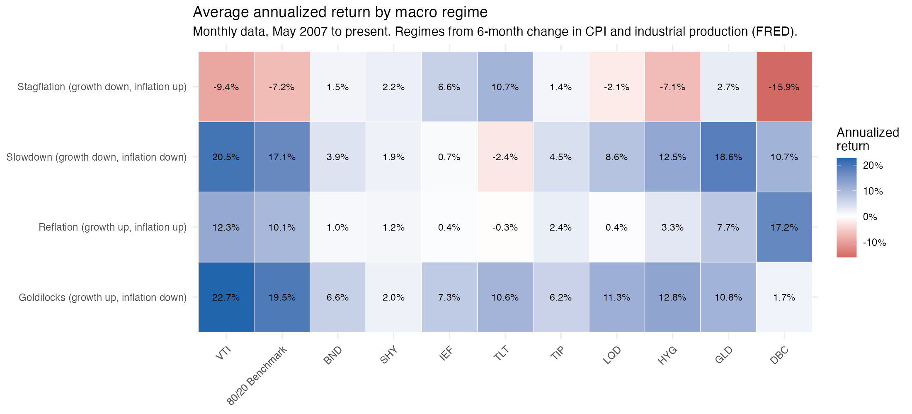
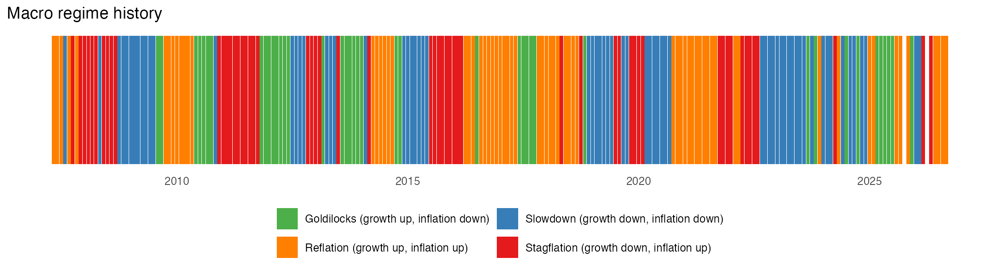

# Macro Regime Analysis: How Asset Classes Perform Across Growth and Inflation Regimes

**Author:** Christopher Ahle · Rensselaer Polytechnic Institute · Built in R

## Overview
How do stocks, Treasuries, credit, TIPS, gold and commodities perform when growth
and inflation are rising or falling, and what does today's regime imply for a
portfolio benchmarked to **80% VTI / 20% BND** (the benchmark of RPI's James
Investment Fund)?

This project classifies every month from May 2007 to the present into one of four
macro regimes using FRED data, then measures the return, volatility, hit rate and
worst month of 10 asset-class ETFs and the 80/20 benchmark in each regime.

## Key Results (annualized returns, May 2007 to present)

| Regime | Months | 80/20 Benchmark | Best asset | Worst asset |
|---|---|---|---|---|
| Goldilocks (growth up, inflation down) | 41 | +19.5% | Stocks (VTI) +22.7% | Commodities (DBC) +1.7% |
| Reflation (growth up, inflation up) | 68 | +10.1% | Commodities (DBC) +17.2% | Long Treasuries (TLT) -0.3% |
| Slowdown (growth down, inflation down) | 67 | +17.1% | Stocks (VTI) +20.5% | Long Treasuries (TLT) -2.4% |
| Stagflation (growth down, inflation up) | 56 | **-7.2%** | Long Treasuries (TLT) +10.7% | Commodities (DBC) -15.9% |

## Findings
1. **Stagflation is the only regime where the 80/20 benchmark loses money.**
   When growth slows and inflation accelerates, the benchmark returned -7.2%
   annualized, driven by stocks (VTI -9.4%), high-yield credit (HYG -7.1%) and
   commodities (DBC -15.9%). In every other regime the benchmark returned at
   least +10%.

2. **Treasuries were the only reliable hedge in stagflation.** Long Treasuries
   (TLT) returned +10.7% and intermediate Treasuries (IEF) +6.6%, while credit
   fell (LQD -2.1%, HYG -7.1%). Duration protected the portfolio when growth
   slowed, even with inflation rising.

3. **In reflation, long duration does not pay.** When growth and inflation both
   accelerate, TLT returned -0.3% and IEF +0.4%, while commodities (+17.2%) and
   stocks (+12.3%) led. Commodities flip from the best asset in reflation to the
   worst in stagflation, so they behave as a bet on growth rather than a pure
   inflation hedge.

4. **Gold and short Treasuries behave differently than commonly assumed.** Gold
   returned only +2.7% in stagflation and did best in slowdowns (+18.6%). Short
   Treasuries (SHY) were positive in every regime (+1.2% to +2.2%): low return,
   but no regime where they lost money.

## What This Means Today
The latest data (September 2026) places the economy in **reflation**, after
several months of stagflation earlier in 2026. Historically this regime has
favored stocks and commodities over long-duration bonds, which supports keeping
fixed income duration shorter than BND. The key risk is a shift back to
stagflation, the one regime where the benchmark loses money. If growth rolls over
while inflation stays high, Treasuries would be the hedge, and stocks, high-yield
credit and commodities the main vulnerabilities.

## Methodology
- **Inflation:** year-over-year change in CPI (FRED: `CPIAUCSL`).
- **Growth:** year-over-year change in industrial production (FRED: `INDPRO`).
- **Regime rule:** inflation (growth) is "up" if its year-over-year rate is higher
  than six months earlier. The two signals combine into four regimes.
- **No look-ahead:** each month's returns are matched to the regime from the prior
  month's data (`LAG = 1`), approximating what an investor would have known.
- **Assets:** VTI (U.S. stocks), BND (U.S. aggregate bonds), SHY / IEF / TLT
  (1-3, 7-10, 20+ year Treasuries), TIP (TIPS), LQD (investment-grade credit),
  HYG (high-yield credit), GLD (gold), DBC (commodities), plus an 80/20 VTI/BND
  benchmark rebalanced monthly.
- **Period:** May 2007 to present (first month all ETFs are available).
- **Metrics:** annualized mean return, annualized volatility, return per unit of
  risk, hit rate (share of positive months) and worst month.

## How to Run
1. Open `macro_regime_analysis.R` in RStudio or the R app.
2. Install packages once:
   `install.packages(c("tidyquant", "tidyverse", "lubridate", "scales"))`
3. Set the working directory to this folder
   (RStudio: Session > Set Working Directory > To Source File Location).
4. Click **Source**.

If FRED times out, download
`https://fred.stlouisfed.org/graph/fredgraph.csv?id=CPIAUCSL,INDPRO` in a browser,
save it in this folder as `fred_data.csv`, and run the script again.

## Outputs
- `regime_summary.csv`: return, volatility, hit rate and worst month by regime and asset
- `regime_heatmap.png`: annualized return by regime and asset
- `regime_timeline.png`: the regime assigned to each month

## Limitations
- **Noisy regime signal:** regimes are based on 6-month changes in CPI and
  industrial production, so they switch often.
- **Direction, not level:** a regime reflects whether growth and inflation are
  rising or falling, not how high they are. For example, much of 2023 had elevated
  but falling inflation and counts as a slowdown.
- **Small samples:** each regime has 41 to 68 months, and single episodes (such as
  2008 within stagflation) heavily influence the averages.
- **One growth measure:** industrial production only; adding unemployment or GDP
  would make the classification more robust.
- **Missing data:** a few recent months have no CPI reading in FRED (including
  around the late-2025 government shutdown), so those months are excluded.
- **Historical averages:** past regime returns may not repeat, and results exclude
  transaction costs and taxes.

## Next Steps
- Test robustness with 3- and 12-month lookback windows.
- Smooth the regime signal (e.g., require two consecutive months to switch).
- Add unemployment as a second growth measure.
- Build a regime-based allocation rule and backtest it against the 80/20 benchmark.

## Data Sources
- Federal Reserve Bank of St. Louis, FRED: CPI (`CPIAUCSL`), Industrial Production (`INDPRO`)
- Yahoo Finance adjusted ETF prices, accessed through the `tidyquant` R package
